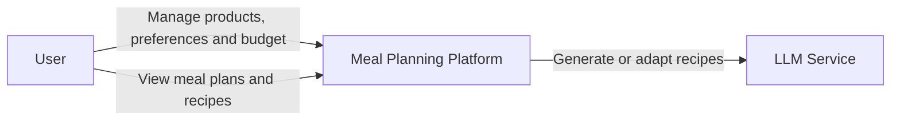
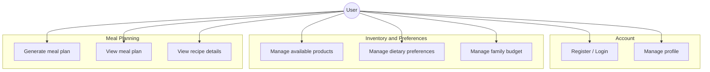
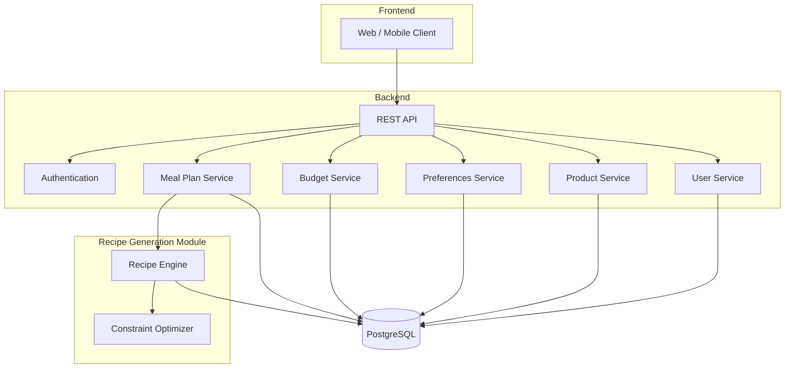

# Architecture Diagrams

## 1. System Context Diagram

The diagram shows the platform and the main external actors.

The user manages available products, dietary preferences and family budget through the platform and receives personalized meal plans. An external LLM service may be used by the recipe generation module.

---

## 2. Use Case Diagram

Main use cases cover account management, inventory and preferences, and meal plan generation and viewing.

---

## 3. Component Diagram

The frontend communicates with the backend through a REST API. The Meal Plan Service uses the Recipe Generation Module to produce plans that satisfy available products, preferences and budget constraints. All persistent data is stored in PostgreSQL.

---

## Notes

Diagrams are written in Mermaid and rendered directly in GitHub. The component diagram is a draft and will be refined during implementation.

---

