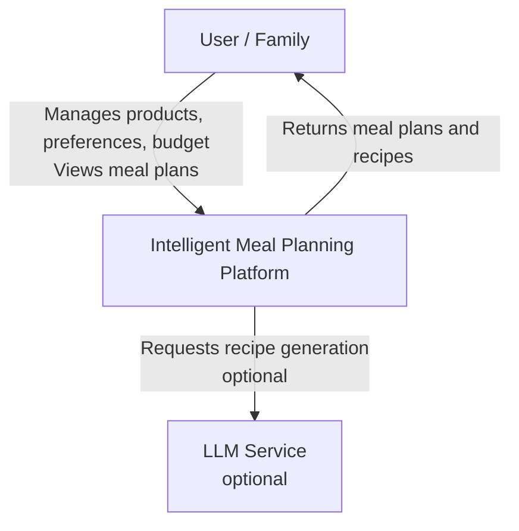
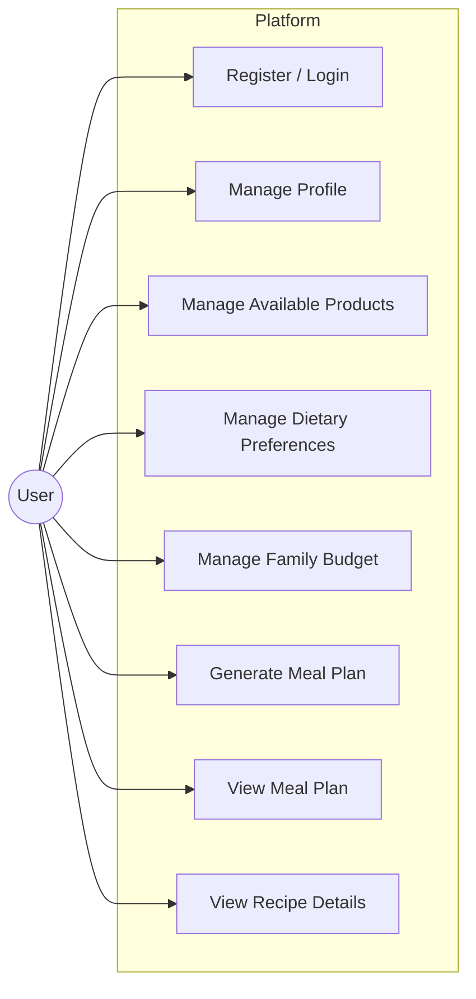
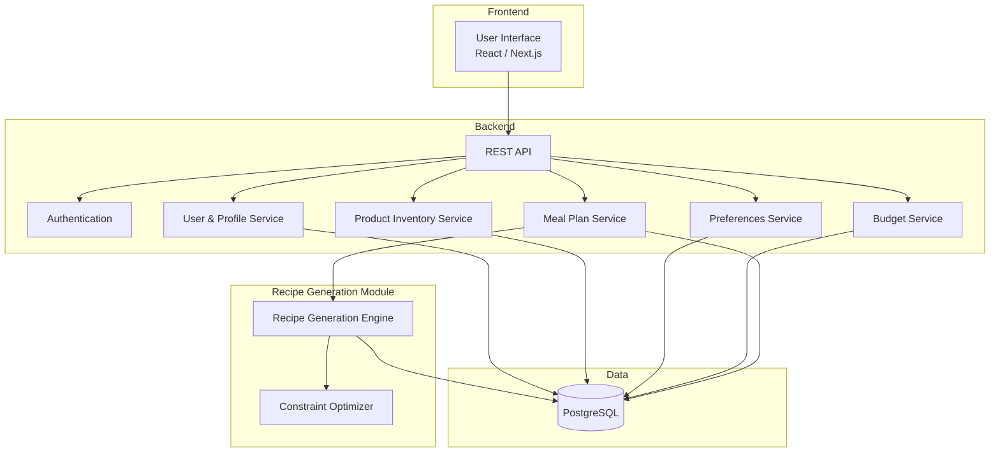

# Architecture Diagrams

## 1. System Context Diagram

The system context diagram shows the platform and its external actors.

**Description:**  
The user interacts with the platform to manage available products, dietary preferences, and family budget, and to receive personalized meal plans and recipes. An optional external LLM service can be used by the recipe generation module.

---

## 2. Use Case Diagram

**Main Use Cases:**
- Register / Login
- Manage Profile
- Manage Available Products
- Manage Dietary Preferences
- Manage Family Budget
- Generate Meal Plan
- View Meal Plan
- View Recipe Details

---

## 3. Component Diagram (Draft)

**Description:**  
- **Frontend** — user interface for managing data and viewing results.  
- **Backend** — REST API and services for users, products, preferences, budget, and meal planning.  
- **Recipe Generation Module** — responsible for generating recipes and meal plans under constraints (available products, preferences, budget).  
- **Database** — PostgreSQL stores users, products, preferences, budget, and recipes.

---

## Notes

- Diagrams are provided in Mermaid format and can be rendered in GitHub or exported to PNG/SVG.
- The Component Diagram is a draft and will be refined during implementation.
- All diagrams are consistent with the requirements defined in UMP-5.

---

**YouTrack:** UMP-6  
**Assignee:** Әли Рауан Мақсатұлы  
**Status:** Draft for pre-defense (October 2026)
